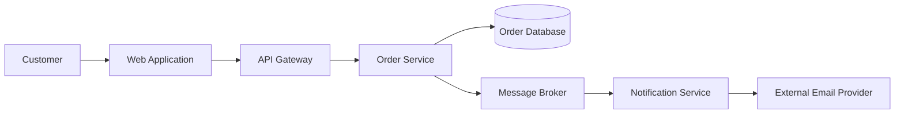
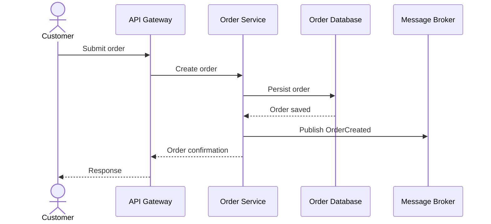

# Architecture Diagrams

## 1. Objective

Define standards for creating clear, consistent, and useful architecture diagrams in High-Level Design (HLD) documents.

Diagrams should communicate architectural structure, interactions, boundaries, deployment topology, data movement, and security controls. They should complement the written design rather than repeat it.

Use Mermaid for diagrams where practical so that they remain text-based, version-controllable, and easy to maintain.

## 2. Diagram Selection

Select diagrams based on architectural complexity and the decisions that need to be communicated. Do not create every diagram type by default.

| Diagram | Purpose | When to Use |
|---|---|---|
| System Context Diagram | Shows the system boundary, users, external systems, and dependencies | To establish the system's place in its environment |
| Container / Component Diagram | Shows major applications, services, modules, and their relationships | To explain the logical architecture |
| Network Architecture Diagram | Shows network zones, connectivity, ingress, egress, and security boundaries | When network topology or connectivity constraints matter |
| Deployment Diagram | Shows runtime environments, infrastructure, deployment units, and hosting topology | When deployment architecture is relevant |
| Data Flow Diagram | Shows how data moves between components and external systems | When data movement, trust boundaries, or sensitive data handling matter |
| Integration Diagram | Shows system-to-system interactions and integration mechanisms | When integrations are architecturally significant |
| Sequence Diagram | Shows the ordered interactions involved in a particular use case | When interaction flows, asynchronous processing, or failure handling need clarification |

Choose the smallest set of diagrams that adequately explains the proposed architecture.

## 3. Diagram Notation and Conventions

### 3.1 General Conventions

- Use clear, descriptive names for systems, components, services, and interfaces.
- Use consistent terminology across diagrams and the HLD text.
- Represent external systems and actors distinctly from internal components.
- Show system boundaries and trust boundaries explicitly where relevant.
- Label connections with the interaction type or protocol when known.
- Use directional arrows to indicate the direction of communication or data flow.
- Avoid unnecessary implementation-level details.
- Avoid unexplained abbreviations and symbols.
- Include a short caption or description explaining the diagram's purpose.

### 3.2 Component Representation

A component should represent a meaningful architectural responsibility, such as:

- Frontend application
- API gateway
- Backend service
- Domain module
- Authentication service
- Message broker
- Database
- External system
- Object storage
- AI agent or agent runtime

Do not represent every class, function, or low-level implementation detail in an HLD diagram.

### 3.3 Relationship Representation

Label relationships wherever the nature of the interaction is important.

Examples:

- REST / HTTPS
- gRPC
- Event publication
- Message consumption
- Database read/write
- File transfer
- Authentication
- Synchronous request
- Asynchronous processing

Distinguish synchronous communication from asynchronous communication when it affects architecture or operational behavior.

## 4. System Context Diagram

The system context diagram should communicate the system's external environment.

Include, where applicable:

- System under design and its boundary.
- Human users and other actors.
- External systems and services.
- Upstream and downstream dependencies.
- Major interaction paths.
- Relevant trust boundaries.

Keep internal component details out of this diagram. Those belong in component or integration diagrams.

## 5. Component Architecture Diagram

The component architecture diagram should show the major logical building blocks of the proposed system.

Include, where applicable:

- Frontend and backend components.
- Services and major modules.
- API gateways and integration adapters.
- Messaging infrastructure.
- Data stores.
- Shared platform capabilities.
- External dependencies.
- Important component relationships.

For existing systems, distinguish unchanged, modified, extended, new, and retired components where this helps explain the architecture delta.

Avoid presenting a complete inventory of every existing component when only a subset is relevant to the change.

## 6. Network Architecture Diagram

Use a network diagram when network topology, connectivity, or isolation is an important architectural concern.

Include relevant elements such as:

- Public and private network zones.
- Virtual networks and subnets.
- Ingress and egress paths.
- Load balancers, gateways, and firewalls.
- Private endpoints and service connectivity.
- Network segmentation and trust boundaries.
- Connectivity to external systems.
- Relevant regional or availability-zone boundaries.

Show important network flows and identify protocols or ports when they are known and architecturally relevant.

Do not invent network topology, IP ranges, firewall rules, or connectivity permissions. Mark unknown details as unresolved.

## 7. Deployment Architecture Diagram

The deployment diagram should show where major application components execute.

Include, where applicable:

- Deployment environments.
- Compute resources and runtime platforms.
- Containers and orchestration platforms.
- Application instances and replicas.
- Managed platform services.
- Databases and storage services.
- Load balancing and traffic routing.
- Availability zones or regions.
- Relevant deployment and scaling boundaries.

Distinguish logical components from their physical or managed runtime environments.

Do not assume that a logical component maps one-to-one to a deployment unit.

## 8. Data Flow Diagram

Use a data flow diagram when understanding data movement is important to the architecture.

Show:

- Data sources and destinations.
- Processing components.
- Data stores.
- Data movement between trust boundaries.
- Important transformations.
- Sensitive data flows.
- External data exchanges.

Where relevant, annotate:

- Data classification.
- Encryption in transit and at rest.
- Data retention or deletion requirements.
- Data residency constraints.
- Whether processing is synchronous or asynchronous.

Do not expose sensitive values, credentials, or production data in diagrams.

## 9. Integration Diagram

Use an integration diagram when multiple systems interact through different integration mechanisms.

Show:

- Participating systems.
- Integration direction.
- API or messaging interfaces.
- Protocols and communication mechanisms.
- Authentication boundaries.
- Synchronous and asynchronous interactions.
- Important failure or retry boundaries.

Identify whether an integration is newly introduced, modified, or reused when documenting an incremental change.

## 10. Sequence Diagram

Use sequence diagrams to explain important runtime interactions that cannot be understood clearly from structural diagrams alone.

Suitable scenarios include:

- A primary business transaction.
- Authentication and authorization.
- Asynchronous event processing.
- External system integration.
- Error handling and retry behavior.
- Human approval within an automated workflow.
- AI agent interactions with tools or other agents.

Show relevant participants, interaction order, responses, and important alternative or failure paths.

Do not use sequence diagrams to describe every possible execution path. Focus on architecturally significant scenarios.

## 11. AI and Agentic System Diagrams

For systems involving AI agents, include additional architectural elements where relevant:

- Agent identity and runtime.
- Model provider or model-serving infrastructure.
- Tool interfaces and MCP servers.
- Agent-to-tool authorization boundaries.
- Agent-to-agent communication.
- Context and memory stores.
- Retrieval and knowledge sources.
- Human approval points.
- Execution sandbox or isolation boundary.
- Audit and observability components.

Make clear which components make decisions, which execute actions, and which enforce authorization.

Do not imply that an agent's own reasoning is an authorization control. Show the enforcement point for tool and resource access.

## 12. Mermaid Guidelines

Prefer Mermaid for text-based diagrams.

Use diagram types appropriate to the information being communicated:

- `flowchart` for system context, component relationships, network topology, and data flows.
- `sequenceDiagram` for runtime interactions.
- `classDiagram` only when structural relationships at the domain or model level are relevant to HLD.

Example component diagram:

Example sequence diagram:

Keep diagrams syntactically valid and ensure that labels are readable.

## 13. Diagram Quality Checklist

Before including a diagram in the HLD, verify:

- The diagram has a clear purpose.
- The diagram represents the proposed architecture, not an unrelated or assumed design.
- Component names match the terminology used in the HLD.
- System and trust boundaries are clear where relevant.
- Relationships and communication directions are understandable.
- Important protocols and interaction types are identified when known.
- Existing and proposed elements are distinguishable when documenting incremental changes.
- The diagram does not contradict the written architecture.
- Unknown details are not presented as confirmed facts.
- The diagram is readable and does not contain unnecessary detail.

## 14. Maintenance Principles

- Update diagrams when architectural decisions change.
- Keep diagrams consistent with the approved HLD baseline.
- Prefer editing the source diagram over maintaining separate screenshots.
- Avoid duplicating the same architectural information across multiple diagrams.
- Use diagrams to explain architectural decisions and relationships, not merely to make the document visually appealing.
- Ensure every diagram adds information that is not already obvious from the surrounding text.